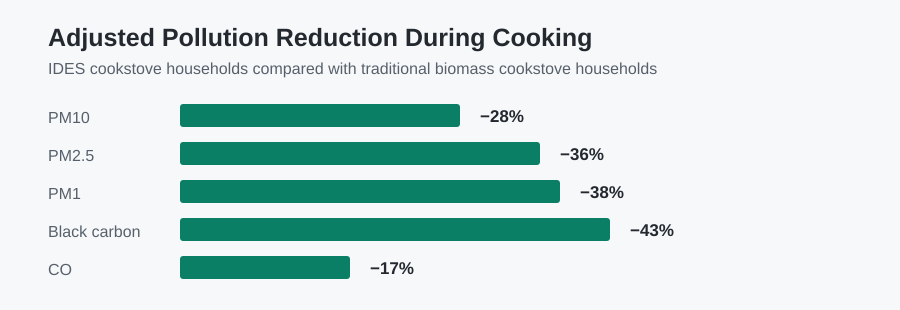
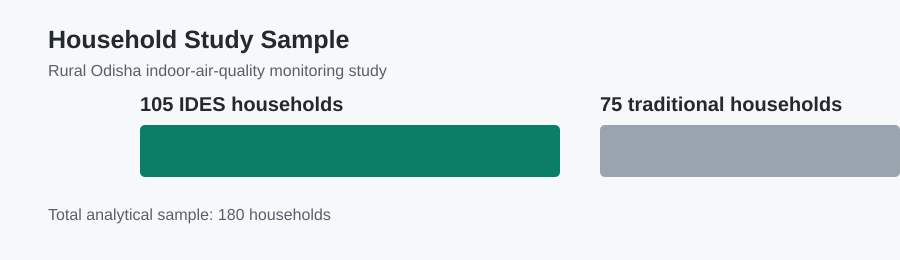

# Household Air Pollution & Improved Cookstove Adoption

← [Back to Portfolio](https://github.com/ksitcode00)

**Context:** UC San Diego environmental-health research · **Tools:** R, regression modeling, mediation, IPW sensitivity analysis

## Executive Summary

This project evaluates whether households using an Integrated Domestic Energy System (IDES) cookstove had lower household air pollution than homes using traditional biomass cookstoves in rural Odisha, India. The analysis compares **105 IDES households** with **75 traditional-cookstove households** while accounting for household infrastructure, electricity access, kitchen setting, village-program context, and other exposure determinants.

In adjusted cooking-period models, IDES use was associated with **28% lower PM10**, **36% lower PM2.5**, **38% lower PM1**, **43% lower black carbon**, and **17% lower carbon monoxide**. Reductions were smaller but still meaningful for 24-hour particle averages, consistent with household exposure being influenced by more than stove type alone.

## My Role

Led the R-based statistical analysis, including survey and monitoring-data cleaning, adjusted pollutant models, respiratory-health models, mediation analysis, propensity-score/IPW sensitivity analysis, diagnostics, and interpretation for manuscript development.

## Quick Review

**[Executive Summary](#executive-summary)** → **[Key Findings](#key-findings)** → **[Analysis Walkthrough](#analysis-walkthrough)** → **[Figures](#figures)** → **[R Pipeline](R/README.md)** → **[Methodology](docs/methodology.md)** → **[Data Privacy](docs/data_privacy.md)**

## Research Question

Were pollutant concentrations lower in IDES households than in traditional biomass-cookstove households, and which household, structural, and programmatic factors were associated with exposure?

## Key Findings

- IDES households had consistently lower pollutant concentrations, with the strongest differences during active cooking periods.
- Adjusted cooking-period reductions were **28% for PM10**, **36% for PM2.5**, **38% for PM1**, **43% for black carbon**, and **17% for carbon monoxide**.
- 24-hour reductions were smaller, approximately 18–20% for PM10, PM2.5, and PM1.
- Electricity access, village-program group, kitchen location, household size, and roof material also contributed to pollutant patterns.
- Mediation and causal-inference sensitivity analyses were used to assess robustness and plausible exposure pathways; results remain observational associations.

## Figures

The figures summarize aggregate results reported in the public analysis. Participant-level monitoring and survey data are not included.

### Adjusted Cooking-Period Reductions



### Study Sample



## Analysis Walkthrough

### 1. Convert restricted source data into analysis variables

The pipeline loads the approved local workbook, creates consistent comparison groups, and ensures the stove-type outcome has an explicit reference category.

```r
df <- prepare_analysis_data(load_study_data())
df$Type <- factor(df$Type, levels = c("Traditional", "Improved"))
```

### 2. Estimate pollutant differences by stove type

For each log-transformed pollutant outcome, the analysis fits a transparent linear model using cookstove type as the comparison variable. The full R Markdown extends these analyses with adjustment, diagnostics, and sensitivity work.

```r
pollutant_models <- fit_pollutant_models(df)
pollutant_summary <- summarize_pollutant_models(pollutant_models)
```

### 3. Review respiratory-health associations

Binary symptom models return odds ratios and confidence intervals for reviewer-friendly interpretation.

```r
wheezing_model <- fit_binary_association(df, "Wheezing", "Type")
odds_ratio_table(wheezing_model)
```

## Program Interpretation

The largest adjusted reductions appeared during the window when cookstove emissions are most direct. Smaller 24-hour reductions are consistent with other real-world exposure sources, ventilation, neighborhood activity, stove stacking, and household behaviors. These findings support cookstove programs alongside broader attention to household conditions and sustained adoption.

## Analysis & Documentation

| Resource | Purpose |
| --- | --- |
| [R analysis](analysis/air_pollution_analysis.Rmd) | Sanitized R Markdown workflow for cleaning, modeling, diagnostics, and sensitivity analysis. |
| [R pipeline](R/README.md) | Separated code-review entrypoints for cleaning, pollutant models, symptom models, and figures. |
| [Methodology](docs/methodology.md) | Study design, analytical workflow, and interpretation boundary. |
| [Reproducibility](docs/reproducibility.md) | Dependency manifest and instructions for creating a local environment. |
| [Data availability](data/README.md) | Restricted-data boundary and expected local path. |
| [Data privacy](docs/data_privacy.md) | Public-release boundary for research materials. |

## Methods

- Survey and monitoring-data cleaning; household and exposure feature engineering
- Distribution checks and log transformation of skewed pollutant outcomes
- Descriptive comparisons and group-difference testing
- Adjusted regression models for log-transformed pollutant concentrations
- Logistic regression for respiratory and lung-function outcomes
- Mediation analysis with bootstrap uncertainty
- Propensity score, stabilized IPW, balance checks, survey-weighted models, and E-value sensitivity analysis

## Data Availability & Limitations

Participant-level data, manuscript drafts under review, internal review documents, and original workbooks are not public. This cross-sectional observational study reports adjusted associations, not definitive causal effects. Results may also reflect background exposure, ventilation, neighborhood activity, and household behavior outside the observed cooking window.

## Local Review

The public R Markdown workflow expects an authorized private source file at `data/private/indoor_air_quality_raw.xlsx`. This path is excluded from version control.

Key R dependencies include `readxl`, `dplyr`, `ggplot2`, `MASS`, `logistf`, `mediation`, `survey`, `cobalt`, and `EValue`.

## Repository Structure

```text
.
├── analysis/       # Sanitized R Markdown analysis
├── R/              # Separated R pipeline entrypoints
├── data/           # Restricted-data documentation only
├── docs/           # Methods and privacy documentation
├── figures/        # Aggregate portfolio figures
└── README.md
```
