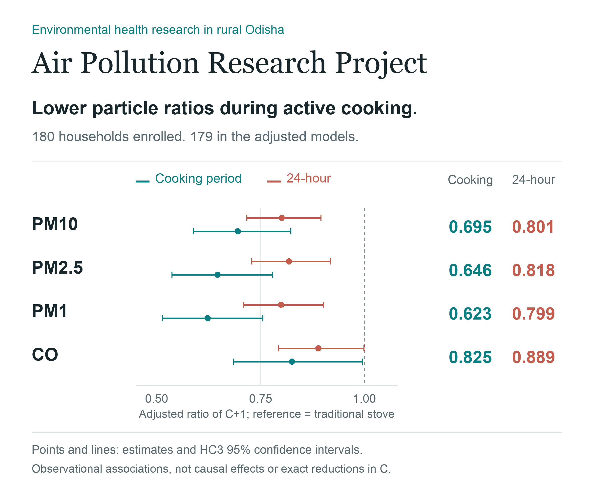
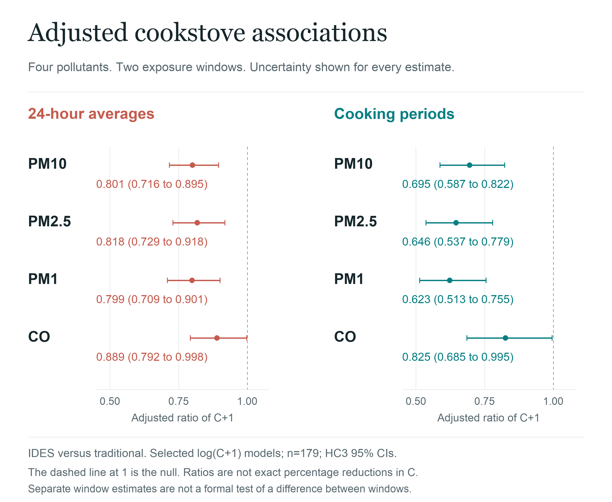
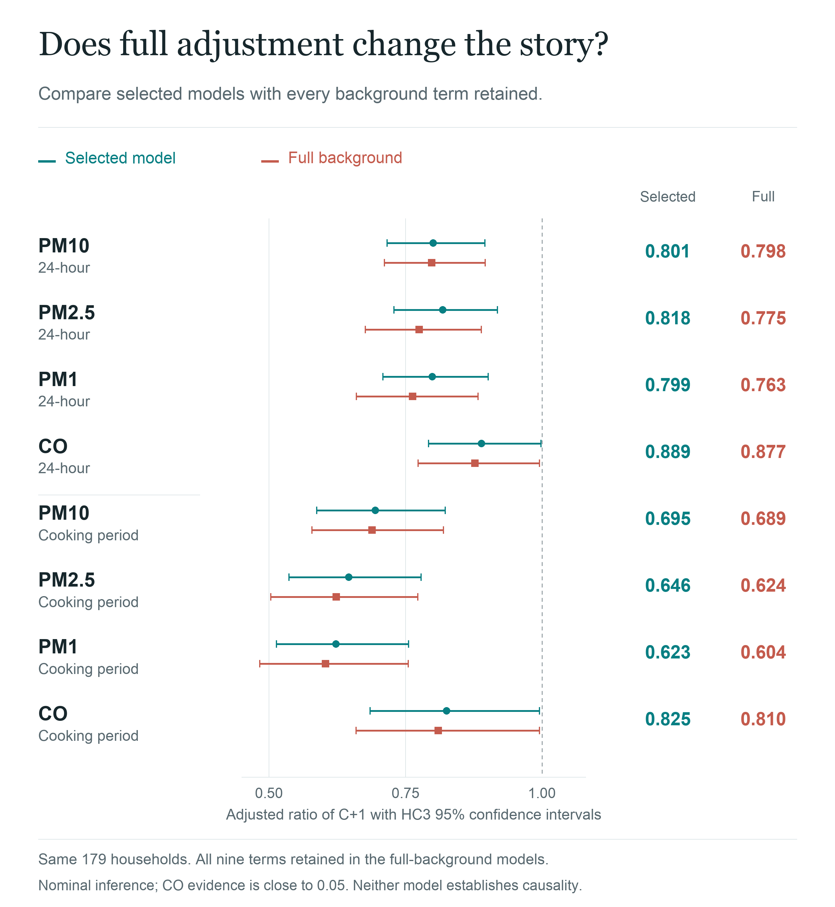
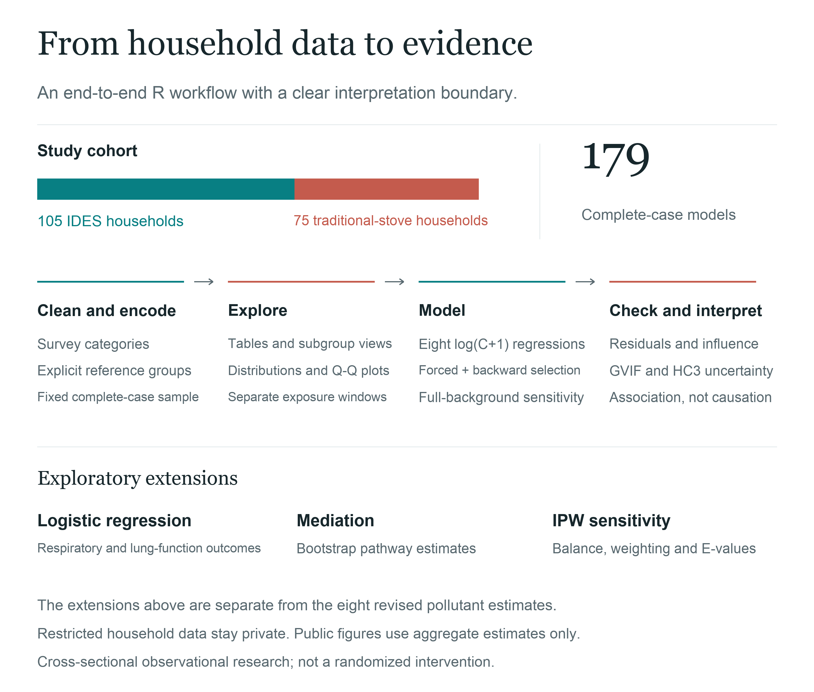

# Air Pollution Research Project

← [Back to Portfolio](https://github.com/ksitcode00)

**Context:** UC San Diego environmental-health research · **Tools:** R, regression modeling, mediation, IPW sensitivity analysis



## Executive Summary

This project evaluates whether households using an Integrated Domestic Energy System (IDES) cookstove had lower household air pollution than homes using traditional biomass cookstoves in rural Odisha, India. The analysis compares **105 IDES households** with **75 traditional-cookstove households** while accounting for household infrastructure, electricity access, kitchen setting, village-program context, and other exposure determinants.

The current adjusted models use **179 complete-case households** from the original cohort of 180. Cooking-period IDES-to-traditional ratios were **0.695 for PM10**, **0.646 for PM2.5**, **0.623 for PM1**, and **0.825 for CO**, with HC3 95% confidence intervals. The corresponding 24-hour particle ratios were closer to 1.

Because the modeled outcome is `log(C+1)`, these estimates compare conditional geometric means of **C+1**, not exact percentage reductions in unshifted concentration C. The findings are observational associations, not causal effects.

## My Role

Led the R-based statistical analysis, including survey and monitoring-data cleaning, adjusted pollutant models, respiratory-health models, mediation analysis, propensity-score/IPW sensitivity analysis, diagnostics, and interpretation for manuscript development.

## Quick Review

**[Executive Summary](#executive-summary)** → **[Key Findings](#key-findings)** → **[Analysis Walkthrough](#analysis-walkthrough)** → **[Figures](#figures)** → **[R Pipeline](R/README.md)** → **[Methodology](docs/methodology.md)** → **[Data Privacy](docs/data_privacy.md)**

## Research Question

Were pollutant concentrations lower in IDES households than in traditional biomass-cookstove households, and which household, structural, and programmatic factors were associated with exposure?

## Key Findings

- All eight adjusted stove-group ratios were below 1 in the selected and full-background models.
- Cooking-period PM2.5 had a ratio of **0.646 (95% CI 0.537 to 0.779)**; the 24-hour estimate was **0.818 (0.729 to 0.918)**.
- Particle ratios were lower during cooking than in the separate 24-hour models. This descriptive comparison is not a formal test of a window-specific effect.
- Full-background sensitivity models retained education, income, roof, ventilation, household size, and all four forced terms. The direction of the associations was preserved.
- CO confidence intervals were close to the null; selected-model p-values were 0.046 and 0.044. Interpret these associations cautiously.
- Respiratory-health modeling, mediation, and IPW sensitivity analysis are exploratory extensions of the broader research workflow, separate from the eight pollutant estimates visualized here.

## Figures

The figures use the [checked aggregate estimates](results/aggregate_stove_associations.csv). Participant-level monitoring and survey data are not included. [Figure definitions and reproduction instructions](figures/README.md) document the source, model specification, and interpretation.

### Eight adjusted associations



**Read the figure:** dots show adjusted ratios; lines show HC3 95% confidence intervals. The dashed line at 1 is the null. Traditional-stove households are the reference.

### Full-background sensitivity



**Adjustment check:** both specifications use the same sample and transformation. The full-background models retain all nine predictor terms without backward removal. Their intervals also exclude 1 under nominal HC3 inference; this does not eliminate unmeasured confounding.

### Analysis workflow



## Analysis Walkthrough

### 1. Convert restricted source data into analysis variables

The pipeline loads the approved local workbook, creates consistent comparison groups, and ensures the stove-type outcome has an explicit reference category.

```r
df <- prepare_analysis_data(load_study_data())
df$Type <- factor(df$Type, levels = c("Traditional", "Improved"))
```

### 2. Estimate pollutant differences by stove type

The reusable R helpers below are entrypoints into the original broad workflow, not a reconstruction of the current adjusted figure snapshot. The current figures use the checked aggregate outputs documented in [methodology](docs/methodology.md) and [figure provenance](figures/README.md).

```r
pollutant_models <- fit_pollutant_models(df)
pollutant_summary <- summarize_pollutant_models(pollutant_models)
```

### 3. Review respiratory-health associations

Binary symptom models return odds ratios and confidence intervals for reviewer-friendly interpretation.

```r
wheezing_model <- fit_binary_association(df, "Wheezing", "Type")
odds_ratio_table(wheezing_model)
```

## Program Interpretation

Lower cooking-period particle ratios suggest an association concentrated in the window when stove emissions are most direct. Separate 24-hour estimates are compatible with exposure being shaped by other sources and household conditions, but they do not establish the mechanism. Cookstove programs should therefore be evaluated alongside sustained use, stove stacking, kitchen conditions, and background exposure.

## Analysis & Documentation

| Resource | Purpose |
| --- | --- |
| [R analysis](analysis/air_pollution_analysis.Rmd) | Sanitized R Markdown workflow for cleaning, modeling, diagnostics, and sensitivity analysis. |
| [R pipeline](R/README.md) | Separated code-review entrypoints for cleaning, pollutant models, symptom models, and figures. |
| [Methodology](docs/methodology.md) | Study design, analytical workflow, and interpretation boundary. |
| [Reproducibility](docs/reproducibility.md) | Dependency manifest and instructions for creating a local environment. |
| [Data availability](data/README.md) | Restricted-data boundary and expected local path. |
| [Data privacy](docs/data_privacy.md) | Public-release boundary for research materials. |
| [Aggregate estimates](results/aggregate_stove_associations.csv) | Sixteen stove-group estimates with HC3 intervals: eight selected and eight full-background models. |
| [Figure builder](scripts/build_portfolio_figures.py) | Reproducible raster graphics from aggregate results only. |

## Methods

- Survey and monitoring-data cleaning; household and exposure feature engineering
- Distribution checks and log transformation of skewed pollutant outcomes
- Descriptive comparisons and group-difference testing
- Adjusted regression models for log-transformed pollutant concentrations
- Four forced terms plus whole-term backward selection at p>0.20; full-background sensitivity without selection
- Model-matched residual, multicollinearity, and influence diagnostics; HC3 95% confidence intervals
- Logistic regression for respiratory and lung-function outcomes
- Mediation analysis with bootstrap uncertainty
- Propensity score, stabilized IPW, balance checks, survey-weighted models, and E-value sensitivity analysis

## Data Availability & Limitations

Participant-level data, manuscript drafts under review, internal review documents, and original workbooks are not public. This cross-sectional observational study reports adjusted associations, not definitive causal effects. Results may also reflect background exposure, ventilation, neighborhood activity, and household behavior outside the observed cooking window. HC3 does not account for village-level dependence or post-selection uncertainty; the displayed intervals are not multiplicity-adjusted. Black carbon appeared in the historical exploratory workflow but is not part of this four-pollutant figure snapshot.

## Local Review

The public R Markdown workflow expects an authorized private source file at `data/private/indoor_air_quality_raw.xlsx`. This path is excluded from version control.

Key R dependencies include `readxl`, `dplyr`, `ggplot2`, `MASS`, `logistf`, `mediation`, `survey`, `cobalt`, and `EValue`.

## Repository Structure

```text
.
├── analysis/       # Sanitized R Markdown analysis
├── R/              # Separated R pipeline entrypoints
├── data/           # Restricted-data documentation only
├── docs/           # Methods and privacy documentation
├── figures/        # Aggregate portfolio figures
├── results/        # Checked aggregate model estimates only
├── scripts/        # Reproducible portfolio figure builder
├── tests/          # Figure data and layout checks
└── README.md
```
